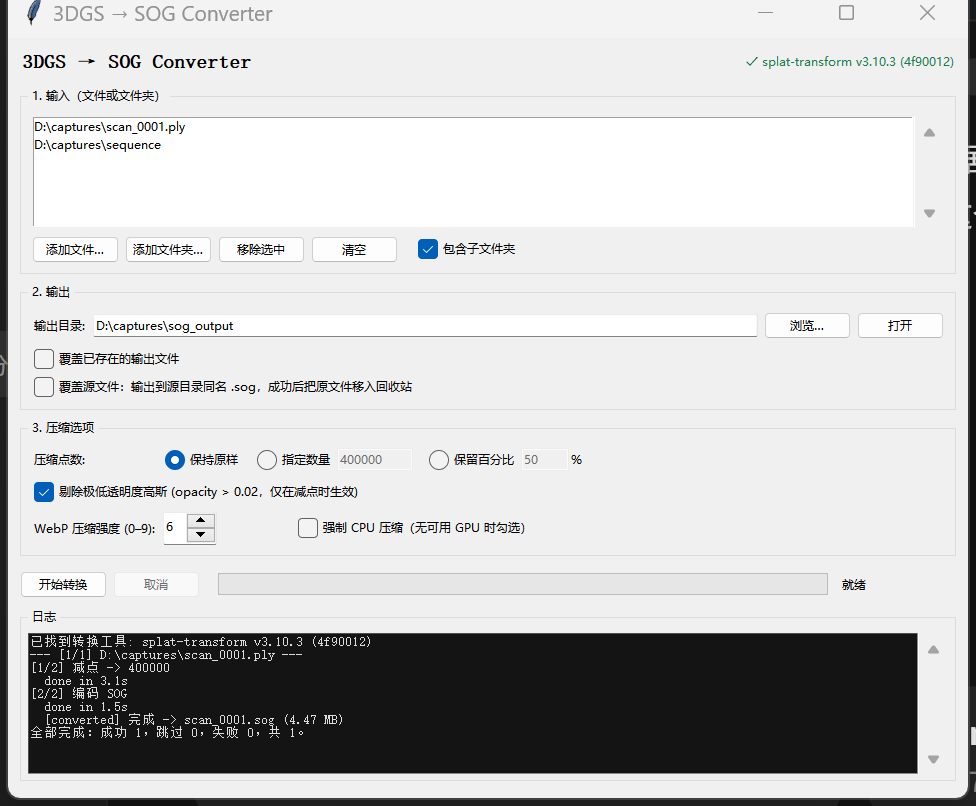

# 3DGS → SOG Converter

一个带图形界面的开源小工具，用于把 3D Gaussian Splatting 文件批量转换为 PlayCanvas 的 **SOG** 格式。

A small, dependency-free desktop GUI that batch-converts 3D Gaussian Splatting
scenes (`.ply` / `.spz` / `.splat` / `.ksplat`) into the compact **SOG** format.

- 纯 Python 标准库（tkinter）编写 GUI，无第三方 Python 依赖
- 转换引擎使用 PlayCanvas 开源的 [`@playcanvas/splat-transform`](https://github.com/playcanvas/splat-transform) CLI
- 支持选择单个文件、多个文件或整个文件夹（可递归）
- 支持指定输出目录、**覆盖源文件**、可选压缩点数
- 所有写入先落临时文件再原子替换，转换失败不会破坏已有输出
- MIT 许可



> 本工具只做格式转换，不含训练或重建能力。SOG 由 PlayCanvas 提出，适合网页与桌面查看器分发。

---

## 效果参考

同一份 64 MB 的 SH0 PLY（1,179,648 个高斯），在本工具对应命令下的实测结果：

| 输出 | 点数 | 体积 |
| --- | --- | --- |
| 原始 PLY | 1,179,648 | 64 MB |
| SOG（保持原样） | 1,179,648 | 11.6 MB |
| SOG（减点到 400K） | 400,000 | **4.5 MB** |

---

## 运行要求

| 依赖 | 版本 | 说明 |
| --- | --- | --- |
| Python | 3.9+ | 必须包含 **tkinter**（python.org 官方安装包默认包含） |
| Node.js | 18+ | 用于运行 `splat-transform` |
| npm | 随 Node.js | 全局安装 CLI |
| 显卡驱动 | 可选 | SOG 编码优先走 WebGPU；无 GPU 时可勾选「强制 CPU 压缩」 |

支持 Windows / macOS / Linux。Windows 下推荐 D3D12 或 Vulkan 驱动。

---

## 安装

```bash
# 1. 安装转换引擎（一次即可）
npm install -g @playcanvas/splat-transform

# 2. 验证
splat-transform --version
```

然后启动 GUI：

```bash
# Windows：双击 run.bat，或
py -3 app.py

# macOS / Linux
chmod +x run.sh
./run.sh

# 通用
python app.py
```

窗口右上角会显示检测到的 CLI 版本。若显示红色的「未找到 splat-transform」，
可设置环境变量 `SPLAT_TRANSFORM` 指向可执行文件，例如：

```bash
# Windows PowerShell
$env:SPLAT_TRANSFORM = "C:\path\to\splat-transform.cmd"

# macOS / Linux
export SPLAT_TRANSFORM=/usr/local/bin/splat-transform
```

---

## 使用步骤

1. **添加输入**：点「添加文件…」选一个或多个文件，或点「添加文件夹…」选整个目录。
   支持的输入后缀：`.ply`（含 `.compressed.ply`）、`.spz`、`.splat`、`.ksplat`。
   「包含子文件夹」控制是否递归扫描。已经是 `.sog` 的文件会跳过。
2. **设置输出**：默认自动填充为首个输入目录下的 `sog_output`，可点「浏览…」改到任意目录。
3. **设置压缩选项**：选择保持点数、指定数量或保留百分比，调整 WebP 强度。
4. **点「开始转换」**：日志区会实时显示实际执行的命令与进度，可随时「取消」。
5. 完成后日志给出「成功 / 跳过 / 失败」统计。

---

## 选项说明

| 选项 | 默认 | 说明 |
| --- | --- | --- |
| 包含子文件夹 | 开 | 文件夹输入是否递归扫描 |
| 输出目录 | `sog_output` | 所有输出的落点；同名文件自动追加 `_2`、`_3` |
| 覆盖已存在的输出文件 | 关 | 关闭时遇到同名 `.sog` 会跳过，不会动旧文件 |
| **覆盖源文件** | 关 | 见下方说明 |
| 压缩点数 | 保持原样 | `保持原样` / `指定数量`（如 400000）/ `保留百分比`（如 34%） |
| 剔除极低透明度高斯 | 开 | 仅在减点时生效，附加 `-V opacity,gt,0.02` |
| WebP 压缩强度 | 6 | `--webp-effort 0-9`，数值越大越慢、体积略小 |
| 强制 CPU 压缩 | 关 | 添加 `-g cpu`；无 GPU 或驱动异常时勾选，速度会明显变慢 |

### 「覆盖源文件」的确切行为

勾选后：

- 输出目录锁定为**源文件所在目录**，文件名与源同名、扩展名改为 `.sog`；
- 「覆盖已存在的输出文件」自动启用；
- 转换成功并通过校验后，**原始文件被移入操作系统回收站**（可从回收站恢复）；
- 启用时会弹出一次警告，每次开始转换前还会列出受影响文件并要求再次确认。

安全边界：

- 只有在输出 `.sog` 成功生成后才会移动原文件；转换失败时原文件保持不动；
- 若输入本身是 `.sog`，该文件会被跳过，避免自覆盖；
- 回收站功能在 Windows 上通过 `SHFileOperationW` 实现。macOS / Linux 下**不会删除原文件**，
  日志会提示「原文件未删除（回收站不可用，请手动处理）」；
- 建议先对少量文件试用，并保留原始素材的独立备份。

---

## 转换原理

`--decimate` 在 `splat-transform` 中必须是最后一个 action 且必须输出 `.ply`，
因此启用减点时分两步执行（中间文件放在系统临时目录，结束后自动清理）：

```bash
# 第一步：减点（可选）
splat-transform input.ply -N -V opacity,gt,0.02 -d 400000 \
  --scratch-dir <temp>/scratch <temp>/decimated.ply

# 第二步：编码 SOG
splat-transform --webp-effort 6 <temp>/decimated.ply output.sog
```

不减点时只需第二步。GUI 里显示的实际命令可直接复制用于批处理或 CI。

所有输出先写为 `.output.__tmp__.sog`，校验非空后用 `os.replace` 原子替换目标文件。

---

## 脚本调用（无 GUI）

`core.py` 不依赖 tkinter，可在批处理脚本或 CI 中直接调用：

```python
from pathlib import Path
from sog_converter import core

cli = core.find_cli()
opts = core.Options(
    output_dir=Path("./out"),
    overwrite_existing=True,
    decimate_mode="count",
    decimate_value=400000,
    webp_effort=6,
)
opts.validate()

sources = core.collect_inputs([r"G:\captures\sequence"], recursive=True)
jobs = core.plan_jobs(sources, opts)
report = core.run_conversion(jobs, opts, cli, log=print)

print(report.converted, report.skipped, report.failed)
```

---

## 常见问题

**Q：提示未找到 splat-transform？**
确认 `npm install -g @playcanvas/splat-transform` 已执行，且 npm 全局 bin 目录在 PATH 中。
也可设置 `SPLAT_TRANSFORM` 环境变量。

**Q：中文路径或带空格的路径能处理吗？**
可以。程序使用参数列表方式调用子进程，不经过 shell 拼接。

**Q：转换时卡住或报 WebGPU 错误？**
勾选「强制 CPU 压缩」重试，或更新显卡驱动。CPU 模式速度会慢 5–10 倍。

**Q：生成的 SOG 在网页端能打开，在别的工具里打不开？**
格式支持取决于具体查看器。SOG 是 ZIP 容器（内含 `.webp` 属性图 + `meta.json`），
PlayCanvas / SuperSplat 系查看器原生支持。
SPZ 是另一套格式（v4 为 ZSTD 容器），部分网页查看器需要额外注册 ZSTD 解码器，
所以两者不能互相替代。用本工具统一转 SOG 即可规避大部分兼容问题。

**Q：Unity 里怎么查看 SOG？**
`aras-p/UnityGaussianSplatting` 原版不直接支持 SOG；
`Enndee/Splatviewer_VR`（Unity 6 / D3D12 / OpenXR）支持运行时加载 bundled `.sog`，
建议 1.2 以上版本。

**Q：点数压缩会损失画质吗？**
会。减点采用渐进式成对合并，`-V` 过滤会移除几乎不可见的高斯。
哑光物体影响较小，金属、玻璃等强反光材质建议保留点数。

---

## 项目结构

```
3dgs-sog-converter/
├── app.py                    # 入口，检测 tkinter 后启动 GUI
├── run.bat / run.sh          # 双击 / 命令行启动脚本
├── sog_converter/
│   ├── __init__.py
│   ├── core.py               # 转换逻辑（无 GUI 依赖）
│   └── gui.py                # tkinter 界面
├── tests/test_core.py        # 单元测试
├── assets/screenshot.png     # 界面截图
├── LICENSE                   # MIT
└── README.md
```

## 运行测试

```bash
python -m unittest discover -s tests -v
```

测试只覆盖核心逻辑，不需要安装 CLI，也不需要图形环境。

---

## 上传到 GitHub 前的检查

- [ ] 把 `LICENSE` 中的版权行改成自己的名字或组织（当前为 `3DGS SOG Converter contributors`）
- [ ] 确认没有把模型文件、日志或 `sog_output/` 提交进仓库（`.gitignore` 已覆盖）
- [ ] 在 GitHub 仓库设置中填写描述与 topics：`3d-gaussian-splatting`、`sog`、`gaussian-splatting`、`converter`

---

## 许可与致谢

本项目代码采用 **MIT License**，详见 [LICENSE](LICENSE)。

转换能力来自以下开源项目，使用时请遵守各自的许可：

- [PlayCanvas splat-transform](https://github.com/playcanvas/splat-transform)（MIT）— 格式转换与 SOG 编码
- [PlayCanvas Engine](https://github.com/playcanvas/engine)（MIT）— SOG 格式与查看器
- [Niantic SPZ](https://github.com/nianticlabs/spz)（MIT）— 支持的输入格式之一

另需注意：若你的 PLY 素材由 INRIA 官方 3DGS 训练代码产出，商业使用需单独确认
[原项目许可](https://github.com/graphdeco-inria/gaussian-splatting/blob/main/LICENSE.md)。
本工具的 MIT 许可不覆盖素材本身的授权。
