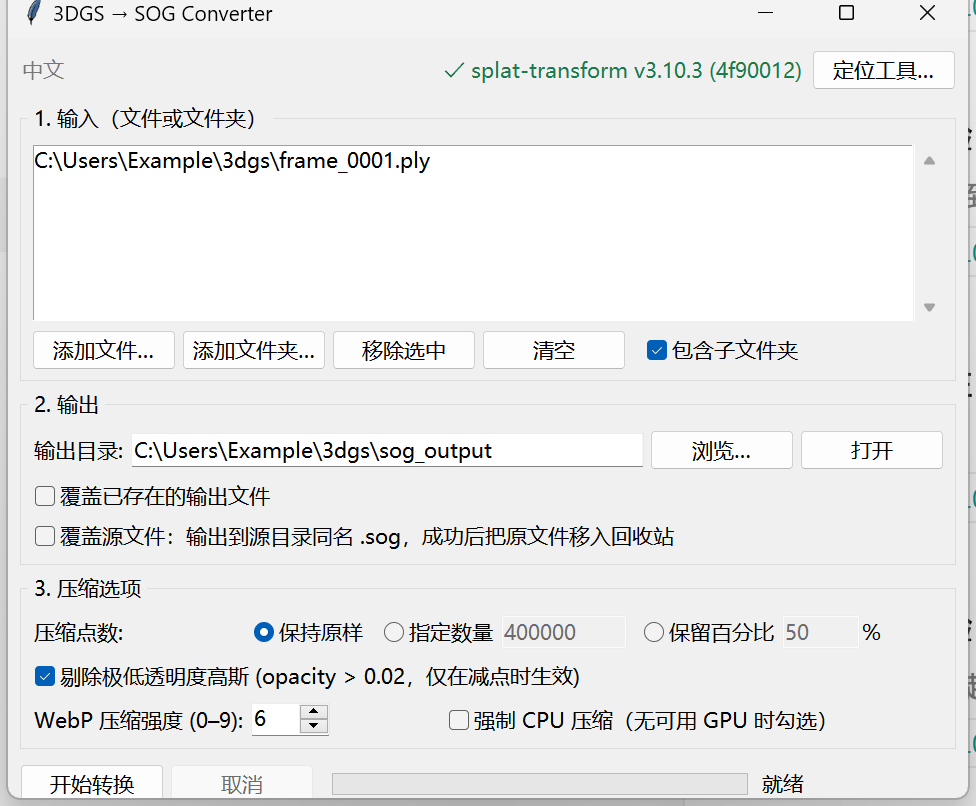
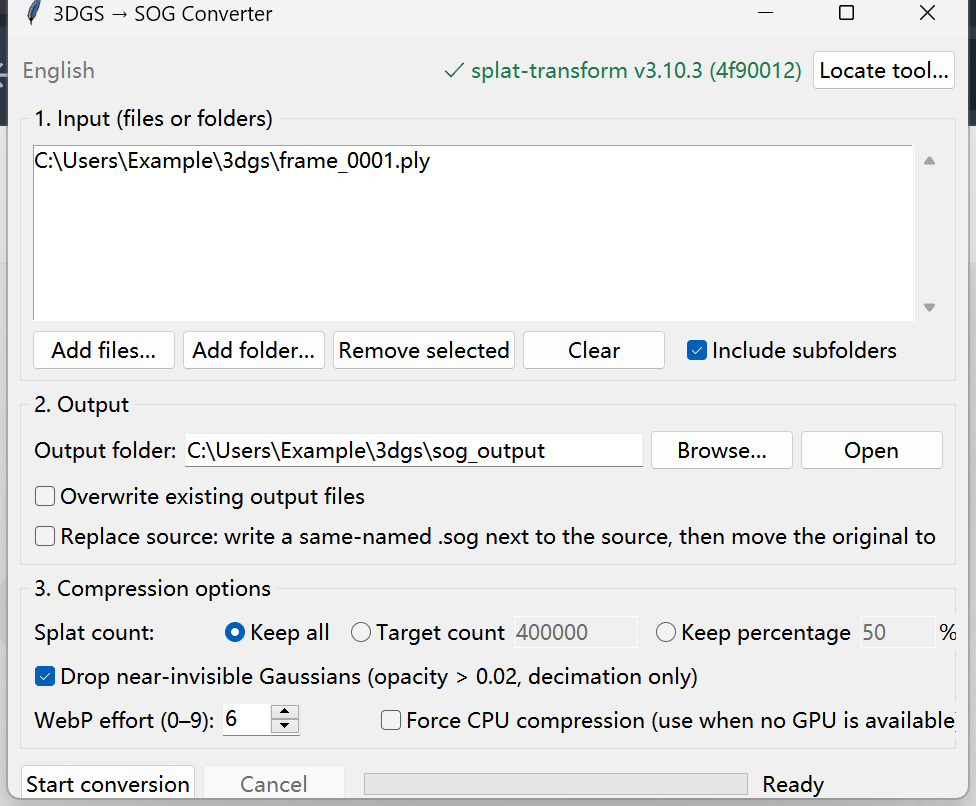

# PLY → 压缩 SOG/PLY 转换器
*PLY → Compressed SOG/PLY Converter*

一个带图形界面的开源小工具，用于把 3D Gaussian Splatting 场景批量转换为 PlayCanvas 的 SOG 格式或压缩后的PLY格式，用于减小文件大小。 
A small open-source desktop GUI for batch-converting 3D Gaussian Splatting scenes into PlayCanvas SOG files or compressed PLY for smaller size.

支持 `.ply`（含 `.compressed.ply`）、`.spz`、`.splat`、`.ksplat`。
Supported: `.ply` (including `.compressed.ply`), `.spz`, `.splat`, `.ksplat`.

  


## 效果参考 Size reference
一份 64 MB 的 SH0 PLY（1,179,648 个高斯）在本工具对应命令下的实测结果。
Measured results for one 64 MB SH0 PLY containing 1,179,648 Gaussians.

| 输出 / Output | 点数 / Splats | 体积 / Size |
| --- | --- | --- |
| 原始 PLY / Raw PLY | 1,179,648 | 64 MB |
| SOG（保持原样） (keep all) | 1,179,648 | 11.6 MB |
| 压缩 PLY（保持原样） (keep all) | 1,179,648 | 18.3 MB |
| SOG（减点到 400K） (decimated to 400K) | 400,000 | 4.5 MB |
| 压缩 PLY（减点到 400K） (decimated to 400K) | 400,000 | 6.2 MB |

## 运行要求 Requirements
Windows / macOS / Linux

| 依赖 / Dependency | 版本 / Version | 说明 / Notes |
| --- | --- | --- |
| Python | 3.9+ | 必须包含 tkinter；python.org 官方安装包默认包含。<br/>Must include tkinter; official python.org builds do. |
| Node.js | 18+ | 用于运行 `splat-transform`。<br/>Required to run `splat-transform`. |
| npm | 随 Node.js / bundled | 全局安装 CLI。 <br/>Used to install the CLI globally. |

## 便携版（免安装） Portable release（免安装）
不想装 Python 和 Node？下载 Release 里的 `3dgs-sog-converter-win64.zip`，解压后双击 `3dgs_sog_converter.exe` 即可，Python、Node.js 与 splat-transform 都已打包在内。可运行 `build_release.py` 自行重新打包。
Don't want to install Python and Node? Grab `3dgs-sog-converter-win64.zip` from the Releases page — Python, Node.js and splat-transform are all bundled; just unzip and double-click `3dgs_sog_converter.exe`. Rebuild it yourself with `build_release.py`.

## 安装 Installation
```bash
# 安装转换引擎
# Install the conversion engine
npm install -g @playcanvas/splat-transform

# 验证
# Verify
splat-transform --version
```

然后用`run.bat`或`run.sh`启动 GUI。 
Then launch the GUI with `run.bat ` or `run.sh`.

窗口右上角会显示检测到的 CLI 版本；若显示红色的「未找到 splat-transform」，点右侧的「定位工具…」按钮手动选择其可执行文件（选择后会被记住，下次自动复用），或设置下面的环境变量。
The top-right corner shows the detected CLI version. If it reports the CLI as missing, click the "Locate tool…" button on the right to pick the executable manually (saved for next launch), or set the environment variable below.

```bash
# Windows PowerShell
$env:SPLAT_TRANSFORM = "C:\path\to\splat-transform.cmd"

# macOS / Linux
export SPLAT_TRANSFORM=/usr/local/bin/splat-transform
```

## 转换原理 How conversion works
```bash
# 第一步：减点（可选）
# Step 1: decimate (optional)
splat-transform input.ply -N -V opacity,gt,0.02 -d 400000 \
  --scratch-dir <temp>/scratch <temp>/decimated.ply

# 第二步：编码 SOG
# Step 2: encode SOG
splat-transform --webp-effort 6 <temp>/decimated.ply output.sog
```

## 脚本调用（无 GUI） Scripting (headless)
```python
from pathlib import Path
from sog_converter import core, i18n

# 日志与错误信息也跟随界面语言
# Log lines and errors follow the selected UI language too
i18n.set_language("en")

cli = core.find_cli()
opts = core.Options(
    output_dir=Path("./out"),
    overwrite_existing=True,
    decimate_mode="count",
    decimate_value=400000,
    webp_effort=6,
)
opts.validate()

sources = core.collect_inputs([r"D:\captures\sequence"], recursive=True)
jobs = core.plan_jobs(sources, opts)
report = core.run_conversion(jobs, opts, cli, log=print)

print(report.converted, report.skipped, report.failed)
```

## 项目结构 Project layout
```
3dgs-sog-converter/
├── app.py                    # 入口 / entry point
├── run.bat / run.sh          # 启动脚本 / launch scripts
├── sog_converter/
│   ├── __init__.py
│   ├── core.py               # 转换逻辑 / conversion logic
│   ├── gui.py                # 界面 / Tkinter UI
│   └── i18n.py               # 中英文字串 / bilingual strings
├── tests/
│   ├── test_core.py
│   └── test_i18n.py
├── assets/                   # 中英界面截图 / UI screenshots
├── LICENSE
└── README.md
```

## 许可与致谢 License and credits
本项目代码采用 MIT License，详见 `LICENSE`。 
The code in this project is released under the MIT License; see `LICENSE`.

转换能力来自以下开源项目，使用时请遵守各自的许可。 
Conversion relies on the following open-source projects; please respect their licenses.

- PlayCanvas `splat-transform`（MIT）：格式转换与 SOG 编码。 
  PlayCanvas `splat-transform` (MIT): format conversion and SOG encoding.
- PlayCanvas Engine（MIT）：SOG 格式与查看器。 
  PlayCanvas Engine (MIT): the SOG format and viewer.
- Niantic SPZ（MIT）：支持的输入格式之一。 
  Niantic SPZ (MIT): one of the supported input formats.

本工具的 MIT 许可不覆盖素材本身的授权。
This tool's MIT License does not cover the licensing of your source assets.
